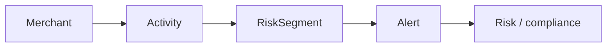

# Risk Segmenter - Brief

## Use case

A payment platform must maintain a live **risk segment** for every merchant: `low` | `medium` | `high`.

That band drives operational decisions: closer review, tighter settlement limits, or a compliance case. Risk-relevant signals arrive throughout the day - chargebacks, settlement spikes, KYC expiry, failed logins - and the platform must react without slowing the payments path.

When such a signal arrives, the platform must:

1. **Record** the activity as a durable fact.
2. **Recompute** the merchant's risk segment from policy.
3. **Notify** risk / compliance so they can act.

These steps are owned by different teams. Notification latency or failure must not block or undo a segment decision. Recording must succeed even if scoring is temporarily unavailable. Other systems (audit, case management) may later need the same facts without forcing changes to the services that already produce them.

### Domain (high level)



| Concept | Meaning |
|---|---|
| Merchant | Account under risk monitoring |
| Activity | Risk-relevant fact (chargeback, velocity breach, KYC expiry, etc.) |
| Risk segment | Current band: `low` / `medium` / `high` |
| Alert | Signal to risk / compliance when the band changes |

## Functional requirements

- Accept and persist risk-relevant merchant activity.
- Derive and store the merchant's current risk segment from policy.
- Emit an alert when a merchant's segment changes.
- Support activity types such as chargeback, velocity breach, KYC expiry, and failed login.
- Expose an API to record activity, and ways to read current segment and alerts.
- Each service owns its own data; no direct access to another service's store.

## Non-functional requirements

- Recording activity must not wait on scoring or notification.
- A failure in notification must not roll back a committed segment change.
- If a consumer restarts, it must still process pending work.
- New consumers of the same facts can be added without changing existing producers.
- Clear ownership: one service per capability, with its own data.
- Shared Postgres is acceptable if data is isolated by schema per service.
- Messaging delivery is at-least-once; duplicate handling is required in consumers.

## Proposed architecture

We propose **3 microservices**, **1 PostgreSQL database** (schema per service), and **GCP Pub/Sub**.

Services are named by capability. Clients call Recording over HTTP. That request is handled as the command `RecordActivity`. After a successful commit, Recording publishes the event `ActivityRecorded`. Segmenter and Notifier react only to events; they are not called over HTTP by Recording.

```
Client
  |  HTTP POST
  v
Recording  --command: RecordActivity-->  persist + commit
schema: recording
  |  event: ActivityRecorded
  v
Segmenter  --event: RiskSegmentChanged-->  Notifier
schema: segmenter                          schema: notifier
```

| Service | Responsibility | Schema | Handles | Publishes |
|---|---|---|---|---|
| Recording | System of record for risk-relevant activity | `recording` | Command `RecordActivity` (HTTP) | Event `ActivityRecorded` |
| Segmenter | Apply versioned rules to set the current segment | `segmenter` | Event `ActivityRecorded` | Event `RiskSegmentChanged` when the band changes |
| Notifier | Operational alert delivery or log | `notifier` | Event `RiskSegmentChanged` | - |

| Message | Kind | Meaning |
|---|---|---|
| `RecordActivity` | Command | Client intent: store this activity now |
| `ActivityRecorded` | Event | Fact: activity was stored |
| `RiskSegmentChanged` | Event | Fact: merchant band changed |

| Pub/Sub | Use |
|---|---|
| Topic `activity-recorded` | Published by Recording |
| Subscription `segmenter-activity-recorded` | Consumed by Segmenter |
| Topic `risk-segment-changed` | Published by Segmenter |
| Subscription `notifier-risk-segment-changed` | Consumed by Notifier |

Handlers are idempotent on `eventId`. Local and CI use the Pub/Sub emulator; the same adapters can target real GCP Pub/Sub without changing service boundaries.

Segmenter uses **versioned, rule-based policy** (deterministic thresholds on activity type and related signals). That keeps decisions explainable and testable for risk / compliance. A scored or model-assisted policy can replace the rules later without changing Recording, Notifier, or the event contracts.

No service reads another service's schema.

## Why this architecture

| Need from the use case | Design choice |
|---|---|
| Record, score, and notify are separate concerns | One microservice and schema per capability |
| Recording must not wait on downstream work | Commit in Recording, then publish; HTTP returns without waiting on Segmenter or Notifier |
| Client intent vs downstream facts | Command at the edge (`RecordActivity`); events between services |
| Notify failure must not undo a segment decision | Segmenter commits first; Notifier is an independent consumer |
| More consumers may appear later | New Pub/Sub subscriptions on existing topics |
| Clear data ownership | Schemas `recording`, `segmenter`, `notifier` only |
| Consumer downtime | Pub/Sub retains unacked messages until ack or deadline |
| Fan-out messaging on GCP-shaped infrastructure | GCP Pub/Sub (emulator locally, real Pub/Sub when deployed) |
| Segment decisions must be explainable and testable | Rule-based policy in Segmenter; rules can evolve behind the same events |

Pub/Sub is chosen because one fact must reach independent consumers with at-least-once delivery. A topic per event type and a subscription per consumer match that model. A heavier log broker is unnecessary for three services; a pure work-queue product fits less well when several consumers must see the same event.

## Implementation shape

One repository, three deployable services, each a container image. Business rules live in the centre of each service; HTTP, Postgres, and Pub/Sub sit at the edges.

Docker Compose runs the full stack for development. The same images can be deployed to a cloud container platform later without changing boundaries.

```
repo/
  docker-compose.yml
  services/
    recording/                 # same shape for segmenter/ and notifier/
      Dockerfile
      src/
        recording/
          domain/
          service_layer/
          adapters/
          entrypoints/
          config.py
      tests/
        unit/
        integration/
        e2e/
    segmenter/
    notifier/
```

| Folder | Holds |
|---|---|
| `domain` | Business model and rules for that service |
| `service_layer` | Handlers for commands and events |
| `adapters` | Postgres (own schema) and Pub/Sub clients |
| `entrypoints` | HTTP API (Recording) or Pub/Sub consumers (Segmenter, Notifier) |

| Runtime | Role |
|---|---|
| `recording` | HTTP API; `RecordActivity` → `ActivityRecorded` |
| `segmenter` | `ActivityRecorded` → maybe `RiskSegmentChanged` |
| `notifier` | `RiskSegmentChanged` → alert log / delivery |
| `postgres` | One DB; schemas `recording`, `segmenter`, `notifier` |
| `pubsub` | Pub/Sub emulator locally; real Pub/Sub in GCP |

Services share the repo for delivery convenience only. They do not share domain code, tables, or HTTP calls between each other.

## Success criteria

- Recording activity does not wait on scoring or notification.
- A failed or stopped Notifier does not undo a committed segment change.
- Stopping and restarting a consumer still processes pending events.
- Adding another consumer does not require changing publishers.
- Each service's data stays in its own Postgres schema.
- End-to-end path works: `RecordActivity` → `ActivityRecorded` → segment update → `RiskSegmentChanged` → alert.
